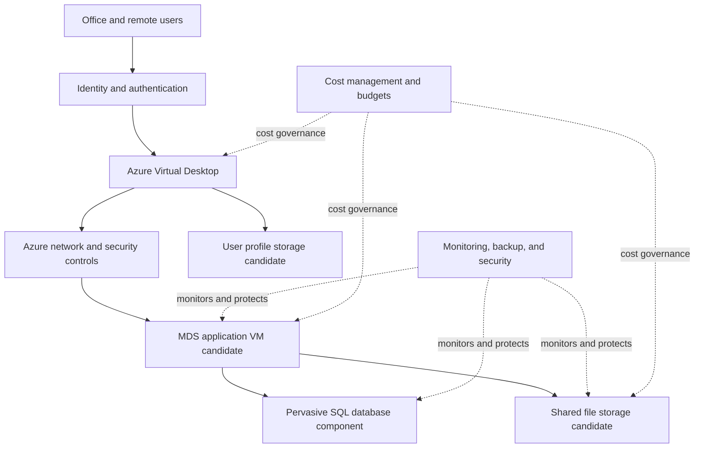

# Argo Azure Migration — Proposed Architecture

## 1. Purpose

This document describes the proposed Azure architecture for migrating Argo's legacy MDS application environment and replacing its existing terminal-server experience.

This is a conceptual design for discovery and planning. It is not a final production design. Vendor compatibility, application dependencies, security requirements, licensing, workload measurements, and client approval must be confirmed before deployment.

## 2. Business Context

The current environment includes:

- MDS running on Windows Server 2012 R2 Standard.
- Pervasive SQL v11 SP2, build 11.20.016.
- An existing MDS server with 8 vCPUs, 28 GB RAM, and approximately 2 TB allocated storage.
- Approximately 60–65 expected concurrent users.
- An application inventory covering approximately 112 users, with overlapping assignments still being reviewed.
- An estimated 5–6 TB of shared files.
- Existing terminal servers TS5, TS6, and TSIH.
- A separate MDS database used by Ivy Hill.

These values are initial discovery inputs. They are not approved Azure sizing specifications.

## 3. Proposed Architecture Diagram

The following Mermaid diagram shows the logical design under consideration.

**Important:** The diagram represents logical relationships, not a validated network topology. Database placement, identity integration, and storage connectivity must be confirmed before implementation.

## 4. Architecture Components

### 4.1 Azure Virtual Desktop (AVD)

**Purpose:** Provide users with a centrally managed desktop or remote application experience.

**Why it is being considered:** The client wants to replace terminal servers TS5, TS6, and TSIH.

**Design considerations:**
- Validate MDS and every required application in an AVD pilot.
- Test scanners, banking tools, Office, Teams, Zoom, Acrobat, Bluebeam, and CrowdStrike requirements.
- Confirm the required session-host configuration and user experience.
- Test the 32-bit Office requirement for the relevant user's MDS purchase-order email workflow.
- Validate licensing and concurrent-user capacity.

The 60–65 concurrent-user estimate must be confirmed through discovery and workload testing.

### 4.2 MDS Application Hosting

**Purpose:** Host the MDS application components required by the business.

An Azure virtual machine is one candidate. The final operating system, VM size, disk configuration, and application placement must be based on vendor support and measured requirements.

Do not select a production VM size solely because it matches the current server's allocated resources.

### 4.3 Pervasive SQL Database

**Purpose:** Continue supporting the database engine required by MDS, if the existing application and database versions are supported in the target environment.

**Critical validation:**
- Confirm supported operating systems and Azure hosting configurations with the vendor.
- Identify database size, growth, performance, backup, and recovery requirements.
- Confirm whether the database should be colocated with MDS or hosted separately.
- Test backup and restore procedures.
- Validate database integrity and application functionality after migration.

Do not replace Pervasive SQL with Azure SQL Database or PostgreSQL without an explicitly approved, vendor-supported migration strategy and application testing.

### 4.4 Shared File Storage

**Candidate service:** Azure Files, subject to compatibility and performance validation.

**Purpose:** Provide shared access to business files from authorized users and applications.

Before selecting the service, confirm:
- Whether the application requires SMB or another protocol.
- Required file and folder permissions.
- Capacity, growth, IOPS, throughput, and latency.
- Identity integration and connectivity.
- Backup, retention, and recovery requirements.
- Whether the estimated 5–6 TB includes database files or other data categories.

### 4.5 User Profiles

**Candidate approach:** FSLogix profile containers with suitable Azure storage, if supported by the final AVD and identity design.

Validate profile sizes, user concurrency, permissions, storage performance, application behavior, and recovery requirements.

Shared business files and user profiles are separate design concerns and should not be assumed to have identical storage needs.

### 4.6 Identity and Access

The identity architecture depends on the client's current environment.

Discovery must identify:
- Active Directory and Microsoft Entra ID usage.
- Domain controllers and DNS dependencies.
- Sign-in and authentication requirements.
- Office and remote-user access requirements.
- Administrative access and role assignments.
- Any required connectivity to existing systems.

Do not assume cloud-only identity or hybrid identity until the current setup has been reviewed.

### 4.7 Network and Security

The target design must define:
- Virtual network and subnet requirements.
- Name resolution and required connectivity.
- Network security rules and restricted administrative access.
- Secure remote access paths.
- Required private connectivity to storage and other services.
- Logging, monitoring, endpoint protection, and security alerting.

Publicly exposing RDP or database ports should not be the default access design.

### 4.8 Backup, Monitoring, and Recovery

The solution should provide an approved approach for:
- VM and application recovery.
- Database-consistent backup and restore.
- Shared-file recovery.
- User-profile recovery.
- Performance and availability monitoring.
- Security and operational alerting.
- Periodic recovery testing.

Backup frequency, retention, recovery time objective (RTO), and recovery point objective (RPO) require client approval.

### 4.9 Cost Management

Before deployment:
- Estimate compute, disks, storage, networking, backups, monitoring, and licensing.
- Confirm the selected Azure region.
- Validate applicable Microsoft and third-party licensing.
- Configure budget alerts and cost reporting.
- Review usage and actual charges during the pilot.

Budget alerts provide notifications; they do not guarantee that spending will stop at a specified amount.

## 5. Infrastructure as Code

The proposed implementation approach is Azure Bicep, subject to team agreement.

The infrastructure code should use validated parameters for appropriate environment-specific values, such as:

- Environment identifier.
- Azure region.
- Resource naming inputs.
- VM size.
- Storage capacity and performance settings.
- Network address ranges.
- Approved tags.
- Resource-specific configuration.

Parameterization must not weaken security. Approved access policies, required encryption, network restrictions, and validation rules should remain explicit.

Secrets, passwords, private keys, connection strings, and confidential client data must not be committed to GitHub.

## 6. Environment Strategy

The proposed lifecycle is:

1. **Discovery:** Gather requirements and validate dependencies.
2. **Development or lab:** Test infrastructure and application compatibility using approved non-production data.
3. **Pilot:** Validate representative users, applications, peripherals, performance, and recovery.
4. **Production:** Deploy only after documented approval and a tested migration and rollback plan.

Production and non-production resources must be clearly separated through appropriate configuration, permissions, naming, and cost controls.

## 7. Key Architecture Decisions Pending

| Decision | Current status |
|---|---|
| AVD session-host design | Pending user and application testing |
| MDS operating system | Pending vendor compatibility confirmation |
| Pervasive SQL placement | Pending vendor and performance validation |
| Azure VM sizes | Pending utilization data and testing |
| Shared file service | Azure Files is a candidate; validation pending |
| User profile design | FSLogix is a candidate; validation pending |
| Identity integration | Pending current-environment discovery |
| Azure region | Pending client approval and service review |
| Backup and disaster recovery | Pending approved RTO, RPO, and retention |
| Licensing | Pending inventory and entitlement review |
| Production migration schedule | Pending client approval |

## 8. Validation and Acceptance

Before production approval, the project should demonstrate that:

- Required users can sign in securely.
- MDS launches and required business workflows work correctly.
- Pervasive SQL operations succeed and data integrity is verified.
- Required applications and peripherals work.
- Shared files and permissions behave as expected.
- The separate Ivy Hill database requirement is addressed.
- Backup and restore procedures have been tested.
- Monitoring and security controls are operational.
- Performance meets agreed acceptance criteria.
- The cost estimate, licensing, and operational ownership are approved.
- A migration and rollback plan is documented and reviewed.

## 9. Current Status

**Phase:** Discovery and architecture planning.

**Deployment:** No production deployment is authorized by this document.

**Next step:** Review the outstanding questions with the client, validate vendor support, and prepare a costed pilot design before creating billable Azure infrastructure.

## 10. Proposed Deployment Layout

This section presents a candidate deployment layout for architecture review. It is not an approved production configuration.

### User Access Layer
- Azure Virtual Desktop is the candidate replacement for TS5, TS6, and TSIH.
- Session-host count and VM sizes will be determined through workload analysis and pilot testing.
- Required applications, peripherals, and user sign-in flows must be validated.

### Application and Database Layer
- MDS and Pervasive SQL remain the existing application and database dependencies.
- Azure VM hosting is a candidate approach, subject to vendor support and workload testing.
- Database placement, operating system, storage configuration, and recovery procedures remain open decisions.
- Ivy Hill's separate database requirement must be assessed independently.

### File and Profile Storage Layer
- Azure Files is a candidate for shared business files, subject to protocol, permissions, performance, and recovery validation.
- FSLogix profile containers are a candidate for AVD profiles, subject to identity and storage compatibility.
- Business files, database files, user profiles, and backups must be inventoried separately.

### Shared Platform Services
- Identity, DNS, networking, administrative access, monitoring, security, and backup services must be designed around the discovered environment.
- Required connectivity and access rules must be documented before implementation.
- Budget monitoring and cost estimates must be reviewed before any billable deployment.

### Deployment Gate
No production deployment should proceed until vendor compatibility, licensing, security, workload sizing, cost, backup and recovery, and migration approvals have been documented.